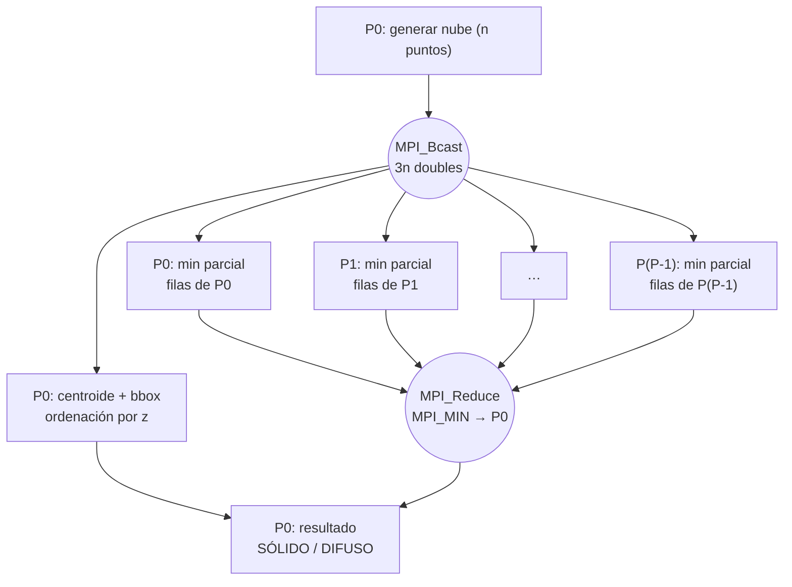
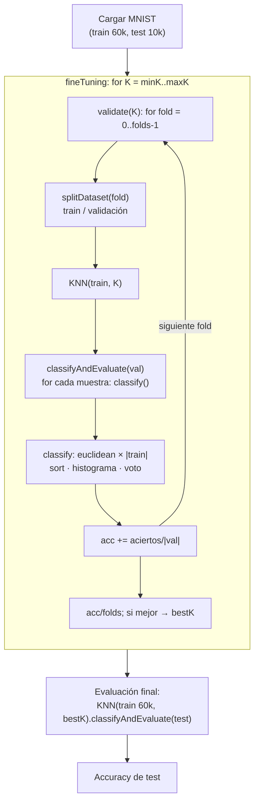
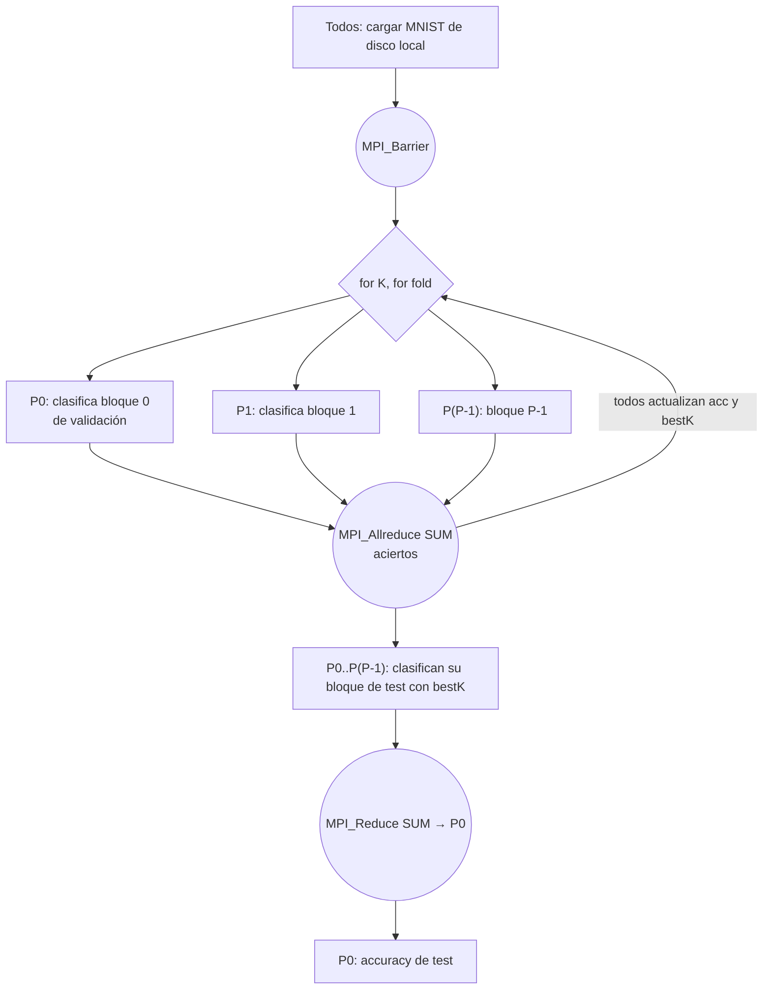
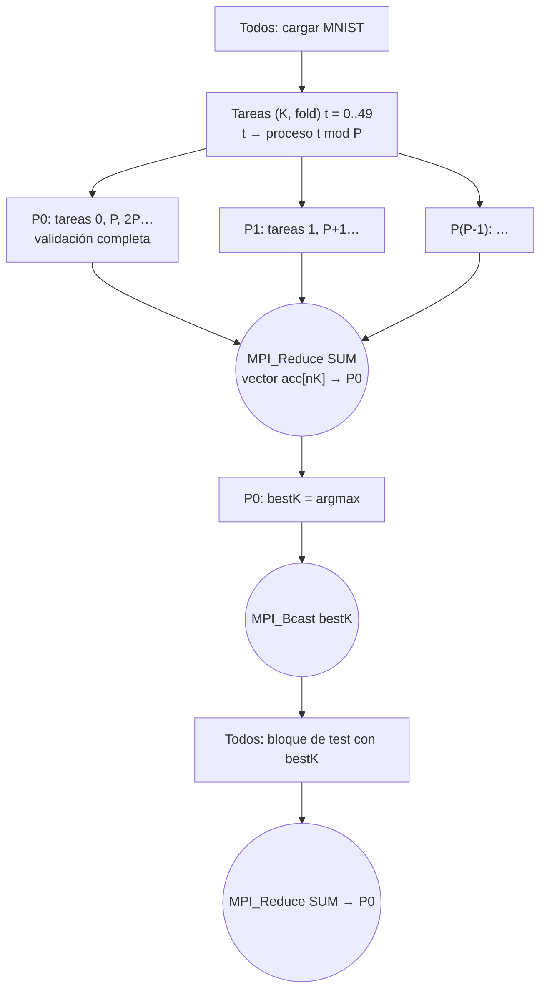
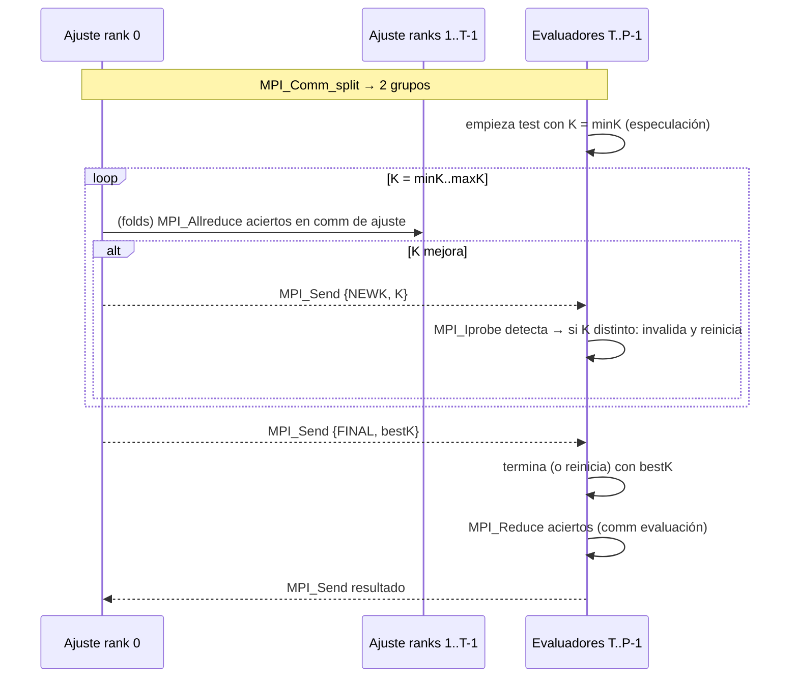

# Práctica 3 — Paralelismo en sistemas de memoria distribuida (MPI)

**Ingeniería de los Computadores — Curso 2026-27**

**Autores:** 📌 ⬜ (nombre y apellidos de los miembros del grupo) — **Grupo de prácticas:** ⬜ — **Fecha:** ⬜

> **Cómo rellenar esta memoria:** todo lo marcado con **📌** se completa con lo obtenido en clase
> (ficheros de `resultados/` y gráficas de `graficas/`). Los huecos **⬜** son números concretos.
> Las tablas completas se generan solas en `resultados/tablas.md` con `python3 scripts/graficas.py`.
> Borra este recuadro antes de entregar.

---

## Índice

1. [Introducción y entorno de pruebas](#1-introducción-y-entorno-de-pruebas)
2. [Tarea 0. Aspectos que impactan en un diseño paralelo](#2-tarea-0-aspectos-que-impactan-en-un-diseño-paralelo)
3. [Tarea 1. Análisis del rendimiento secuencial con gprof](#3-tarea-1-análisis-del-rendimiento-secuencial-con-gprof)
4. [Tarea 2. Ejecución distribuida de código MPI](#4-tarea-2-ejecución-distribuida-de-código-mpi)
5. [Tarea 3. Paralelización del código de la práctica 2](#5-tarea-3-paralelización-del-código-de-la-práctica-2)
6. [Tarea 4. Paralelización de un clasificador kNN con MPI](#6-tarea-4-paralelización-de-un-clasificador-knn-con-mpi)
7. [Conclusiones](#7-conclusiones)
8. [Fuentes y herramientas utilizadas](#8-fuentes-y-herramientas-utilizadas)

---

## 1. Introducción y entorno de pruebas

El objetivo de la práctica es paralelizar con **MPI** (paso de mensajes, memoria distribuida) dos programas:
el código propio de la práctica 2 (detección de obstáculos LIDAR, cuyo cuello de botella es el cálculo
del par de puntos más cercano) y el clasificador **kNN** sobre MNIST proporcionado por el profesorado.
Antes de paralelizar se estudia cómo afecta la gestión de memoria al rendimiento (Tarea 0) y se
localizan los cuellos de botella con **gprof** (Tarea 1). Todas las versiones paralelas se han
ejecutado en un clúster de **⬜ (≥3) PCs** del laboratorio.

### 1.1 Arquitectura del sistema utilizado

📌 Rellenar con `resultados/sistema_<pc>.txt` (salida de `scripts/info_sistema.sh`).

| Característica | Valor |
|---|---|
| Nº de nodos (PCs) del clúster | ⬜ |
| Procesador (modelo) | ⬜ |
| Sockets × núcleos físicos × hilos por núcleo | ⬜ × ⬜ × ⬜ |
| Frecuencia | ⬜ GHz |
| Caché L1d / L1i (por núcleo) | ⬜ KB / ⬜ KB |
| Caché L2 (por núcleo) | ⬜ |
| Caché L3 (compartida) | ⬜ MB |
| Memoria RAM | ⬜ GB |
| Red de interconexión | Ethernet ⬜ Mb/s (switch del laboratorio) |
| Sistema operativo | ⬜ |
| Implementación MPI | Open MPI ⬜ |
| Compilador | g++ ⬜ (`-O2 -std=c++17`) |

| Nodo | IP | Núcleos (slots) |
|---|---|---|
| maestro | ⬜ | ⬜ |
| nodo 2 | ⬜ | ⬜ |
| nodo 3 | ⬜ | ⬜ |

El sistema es un **multicomputador de memoria distribuida** (cluster): cada nodo es a su vez un
multiprocesador de memoria compartida (varios núcleos con L3 común), pero entre nodos no hay memoria
compartida y toda la información se intercambia por la red Ethernet mediante MPI. Esto implica dos
costes de comunicación muy distintos: entre procesos del **mismo nodo** (Open MPI usa memoria
compartida, latencia ~µs) y entre procesos de **distintos nodos** (TCP sobre Ethernet, latencia de
decenas de µs y ancho de banda de ~⬜ MB/s). Los procesos se reparten entre nodos con
`--map-by node` (rank 0 → PC1, rank 1 → PC2, rank 2 → PC3, rank 3 → PC1…), de modo que desde P = 3
el programa ya usa los tres computadores.

### 1.2 Estructura del código entregado

| Fichero | Contenido |
|---|---|
| `tarea0/vector.cpp`, `tarea0/matriz.cpp` | Códigos del enunciado con el tamaño como argumento |
| `tarea2/hello_mpi.c` | Hola mundo MPI |
| `tarea3/lidar_seq.cpp` | Práctica 2 secuencial (referencia) |
| `tarea3/lidar_mpi.cpp` | **Práctica 2 paralelizada con MPI** (reparto por bloques y cíclico) |
| `tarea4/knn2/main_seq.cc` | kNN secuencial original con la talla por parámetro (referencia) |
| `tarea4/knn2/knn_mpi.cc` | **kNN paralelizado con MPI**: estrategias `datos`, `tareas` y `especulativo` |
| `scripts/*.sh`, `scripts/graficas.py` | Montaje del clúster, perfilado, baterías de pruebas y gráficas |

---

## 2. Tarea 0. Aspectos que impactan en un diseño paralelo

Ambos programas se han compilado con `-O0` (para que el compilador no elimine ni transforme los
bucles) y se han ejecutado con distintos tamaños (`scripts/bench_tarea0.sh`). En `matriz.cpp` se ha
sustituido `int a[SIZE][SIZE]` (en la pila) por un `std::vector` de `SIZE*SIZE` elementos, porque
con tamaños a partir de ~1450 la matriz (≥ 8 MB) no cabe en la pila (límite típico de 8 MB) y el
programa aborta con *segmentation fault*. El patrón de acceso (`a[j][i]` frente a `b[i][j]`) es
exactamente el mismo.

### 2.1 El problema de los vectores dinámicos

**¿Qué diferencias observáis entre ambas versiones?**
En la versión **A** el vector se crea vacío y crece con `push_back`; en la **B** se crea ya con
`SIZE` elementos y solo se escriben las posiciones (`b[i] = i`).

**¿Qué versión es más rápida?**
La **B**. En nuestras medidas la ganancia A/B es de ≈ **⬜×** para SIZE = 10⁶ y se mantiene entre
⬜× y ⬜× para todos los tamaños (📌 tabla 2.3).

**¿A qué se debe la diferencia?**
`std::vector` guarda sus elementos en un bloque contiguo del *heap* con una capacidad. Con
`push_back`, cada vez que el tamaño alcanza la capacidad el vector debe **reservar un bloque nuevo
más grande** (crecimiento geométrico, ×2 en libstdc++), **copiar/mover todos los elementos** y
liberar el bloque anterior: ≈ log₂(10⁶) ≈ 20 realocaciones que mueven en total ~2·SIZE elementos.
Además, cada `push_back` comprueba la capacidad y actualiza el tamaño (y con `-O0` es una llamada a
función real). En la versión B hay **una única reserva** y el bucle es una escritura directa a
memoria, que además es fácilmente vectorizable.

**¿Se podrían paralelizar ambas versiones?**
- **B sí**: cada iteración escribe una posición distinta (`b[i] = i`) y no depende de ninguna otra
  → paralelismo de datos puro; el rango `[0, SIZE)` se puede repartir entre procesos/hilos.
- **A no directamente**: `push_back` modifica el estado compartido del vector (tamaño, capacidad y,
  en una realocación, el propio puntero a los datos). Cada iteración depende de la anterior (el
  elemento i se coloca en la posición que deja la i−1), así que hay una **dependencia verdadera**
  entre iteraciones y ejecutarlas a la vez provocaría condiciones de carrera. Para paralelizarla habría
  que transformarla en la versión B (reservar primero) o que cada proceso rellene su propio vector
  local y luego se concatenen (en MPI: `MPI_Gather`/`MPI_Gatherv`).

### 2.2 Recorrido de matrices

**¿Qué diferencias hay entre ambas versiones?**
Las dos escriben los mismos valores, pero A recorre la matriz **por columnas** (`a[j][i]`: el índice
que varía en el bucle interno es la fila) y B **por filas** (`b[i][j]`). En C/C++ las matrices se
almacenan por filas (*row-major*), así que B accede a posiciones **consecutivas** de memoria
(salto de 4 bytes) y A salta `SIZE·4` bytes entre accesos consecutivos.

**¿Qué versión se ejecuta más rápido?** La **B** (por filas), con una ganancia de hasta ≈ **⬜×**.

**¿A partir de qué tamaño comienza a notarse la diferencia?**
📌 Según nuestra tabla, la diferencia empieza a ser apreciable a partir de SIZE ≈ **⬜**
(matriz de ⬜ MB). Por debajo, la matriz completa cabe en la caché (L2 = ⬜, L3 = ⬜ MB) y
ambos recorridos tardan lo mismo. Cuando la matriz deja de caber en caché, el recorrido por columnas
falla en casi cada acceso.
*(Referencia: SIZE = 1000 → 4 MB; 2000 → 16 MB; 4000 → 64 MB. Con L3 de ⬜ MB el salto debería
aparecer entre 1000 y 2000-4000.)*

**¿A qué se debe la diferencia de tiempo?**
A la **localidad espacial** y a la jerarquía de memoria. La memoria se transfiere a la caché en
**líneas de 64 bytes** (16 enteros). En el recorrido por filas, un fallo trae 16 elementos que se
usan a continuación (1 fallo cada 16 accesos) y el *prefetcher* hardware detecta el patrón
secuencial. En el recorrido por columnas cada acceso cae en una línea distinta; para cuando se vuelve
a usar el resto de esa línea (en la siguiente columna) ya ha sido expulsada si `SIZE` líneas no caben
en caché, con lo que hay ≈ 1 fallo por acceso y además fallos de TLB (cada salto de `SIZE·4` bytes
cambia de página de 4 KB cuando SIZE ≥ 1024).

### 2.3 Mediciones

📌 Copiar de `resultados/tablas.md` (sección *Tarea 0*) y comprobar que se ve la gráfica.

| SIZE (vector) | t A push_back (s) | t B prealocado (s) | Ganancia |
|---|---|---|---|
| 10⁶ | ⬜ | ⬜ | ⬜ |
| … | | | |

| SIZE (matriz) | t A columnas (s) | t B filas (s) | Ganancia |
|---|---|---|---|
| 1000 | ⬜ | ⬜ | ⬜ |
| … | | | |


### 2.4 Entregable: cambios necesarios antes de aplicar MPI

A partir de estas conclusiones hemos aplicado los siguientes cambios antes de paralelizar:

1. **Reservar memoria antes de rellenar vectores** (`reserve()` o tamaño en el constructor). En el kNN
   original `KNN::classify` hace `push_back` de un `KNNResult` por cada muestra de entrenamiento
   (decenas de miles de veces por muestra clasificada) sin reservar; el constructor de `KNN` y
   `CrossValidation::splitDataset` copian el conjunto con `push_back`. En `knn_mpi.cc` todos estos
   vectores se reservan con antelación y el buffer de resultados se **reutiliza** entre muestras.
   En la práctica 2 `generar_obstaculo` ya hacía `reserve(n)`.
2. **Evitar copias innecesarias del conjunto de datos**: el constructor de `KNN` copiaba el
   entrenamiento completo; en la versión MPI la clasificación trabaja con referencias `const &`, y en la
   estrategia de datos los *folds* se construyen una sola vez (no una vez por cada K).
3. **Datos contiguos para poder enviarlos con MPI**: MPI envía **bloques contiguos** de memoria
   (`buffer, count, tipo`). En la práctica 2, `std::vector<Point3D>` con `Point3D = {double x,y,z}` es
   un bloque contiguo de `3n` doubles, por lo que se puede difundir con una sola llamada
   `MPI_Bcast(nube.data(), 3n, MPI_DOUBLE, ...)`. En cambio, en el kNN cada `TSample` contiene un
   `std::vector<float>` propio (los píxeles están dispersos por el *heap*), así que enviar el dataset
   exigiría serializarlo (o un tipo derivado). Por eso hemos decidido que **cada proceso lea MNIST de
   su disco local** (el dataset está copiado en todos los nodos) y no se transmite ningún píxel por la red.
4. **Recorrer los datos en el orden en que están en memoria**: la distancia euclídea recorre los
   píxeles de cada imagen de forma secuencial (row-major) y el par más cercano recorre el vector de
   puntos de forma secuencial en el bucle interno; ambos ya respetan la localidad espacial.
5. **Matrices grandes en el heap, no en la pila**, por lo visto en `matriz.cpp`.

---

## 3. Tarea 1. Análisis del rendimiento secuencial con gprof

### 3.1 Metodología

Con `scripts/gprof.sh` se compilan ambos programas con `-pg -g -fno-inline` y dos niveles de
optimización (`-O0` y `-O2`), se ejecutan y se genera el informe con `gprof -b -p -q`:

- Práctica 2: `./lidar_prof_O? 50000 1.5 15.0 42` (n = 50 000 puntos).
- kNN: `./knn_prof_O? 2000 10000 500 1 10 5` (validación cruzada de 5 folds con 2 000 muestras,
  K ∈ [1,10], evaluación final de 500 muestras de test frente a 10 000 de entrenamiento).

`-fno-inline` evita que las funciones pequeñas desaparezcan al optimizar y aparezcan atribuidas a su
llamante. Los tiempos de gprof son muestreados (cada 10 ms) y el número de llamadas es exacto.

### 3.2 Código propio (práctica 2, LIDAR)

📌 Insertar las gráficas generadas y completar la tabla con `resultados/gprof_lidar_O0.txt` / `_O2.txt`.


| Función | % tiempo -O0 | % tiempo -O2 | Llamadas |
|---|---|---|---|
| `distancia_minima_entre_puntos` | ⬜ | ⬜ | 1 |
| lambda de comparación de `std::sort` (`ordenar_por_profundidad`) | ⬜ | ⬜ | ⬜ (≈ n·log₂n) |
| `generar_obstaculo` | ⬜ | ⬜ | 1 |
| `centroide_y_bbox` | ⬜ | ⬜ | 1 |

**Conclusión:** `distancia_minima_entre_puntos` concentra prácticamente todo el tiempo (≈ ⬜ %).
Se llama **una sola vez**, pero su coste individual es enorme: es O(n²), n(n−1)/2 ≈ 1,25·10⁹
comparaciones para n = 50 000, frente a O(n) del centroide y O(n log n) de la ordenación.
Medido con los temporizadores del propio programa (n = 100 000): par más cercano 2,41 s, ordenación
0,008 s y centroide 0,0002 s, es decir, **la parte no paralelizada es < 0,4 %**.
Entre `-O0` y `-O2` el reparto apenas cambia (con `-O2` la ordenación pesa todavía menos porque la
lambda de comparación se optimiza), así que la función a paralelizar es la misma en ambos casos.
Es una función de **coste individual elevado y pocas llamadas**: el paralelismo hay que buscarlo
**dentro** de ella (en su doble bucle), no repartiendo llamadas.

### 3.3 Código proporcionado (kNN)

📌 Insertar gráficas y completar con `resultados/gprof_knn_O0.txt` / `_O2.txt`.


Número de llamadas esperado (exacto, se puede comprobar en el informe):
- `euclidean`: 10 K × 5 folds × 400 validación × 1 600 entrenamiento + 500 × 10 000 = **37 000 000**.
- `KNN::classify`, `histogram`, `maxVotesLabel` y `std::sort`: 10 × 2 000 + 500 = **20 500**.
- `CrossValidation::validate`: 10; `splitDataset`: 50; `KNNResult(const TSample&, const TSample&)`: 37 000 000.
- `TSample::TSample` (carga + redimensionado de MNIST): 70 000.

| Función | % tiempo -O0 | % tiempo -O2 | Llamadas | Tipo de coste |
|---|---|---|---|---|
| `euclidean` | ⬜ | ⬜ | 37 000 000 | muchas llamadas, barata (196 píxeles) |
| `std::sort` / `__introsort_loop`, `__unguarded_partition`, `operator<` | ⬜ | ⬜ | ⬜ | ordenar 1 600–10 000 distancias por muestra |
| `KNNResult::KNNResult` / `vector::push_back` / `_M_realloc_insert` | ⬜ | ⬜ | ⬜ | realocaciones (Tarea 0) |
| `TSample::TSample` | ⬜ | ⬜ | 70 000 | carga de datos |
| `CrossValidation::splitDataset` + copias de `TSample` | ⬜ | ⬜ | ⬜ | copias de datos |

**Conclusión:** el tiempo se concentra en `KNN::classify` y sus llamadas: el cálculo de **distancias**
(`euclidean`, ≈ ⬜ %) y la **ordenación** de todos los resultados (≈ ⬜ %). Son funciones que se
ejecutan **muchísimas veces** con un coste individual pequeño, y cada llamada a `classify` es
**independiente** de las demás (solo lee los datos de entrenamiento). Con `-O0` aparecen además con
peso relevante `push_back`, los constructores/destructores y los operadores de los iteradores de la
STL, que con `-O2` casi desaparecen (se optimizan), por lo que el perfil `-O2` es el representativo:
con optimizaciones `euclidean` es aún más dominante (se vectoriza) / ⬜ (comentar lo observado).
La carga de MNIST (`loadMnist`, `TSample::TSample`) es un coste fijo pequeño.

### 3.4 Conclusiones de la tarea

| Programa | Candidata | Motivo | Granularidad elegida |
|---|---|---|---|
| LIDAR (P2) | `distancia_minima_entre_puntos` | > 99 % del tiempo, O(n²), iteraciones independientes | filas `i` del doble bucle |
| kNN | `KNN::classify` (→ `euclidean` + `sort`) dentro de `validate` y de la evaluación final | ≈ ⬜ % del tiempo, millones de llamadas independientes | muestras a clasificar, o pares (K, fold) completos |

---

## 4. Tarea 2. Ejecución distribuida de código MPI

### 4.1 Configuración del clúster

Siguiendo el tutorial del enunciado (automatizado en `scripts/setup_cluster.sh`):

1. Mismo usuario en todos los PCs y el proyecto en la **misma ruta** (`~/prac3_ic`) en todos.
2. Fichero `hosts` con una IP por línea y el número de *slots* (núcleos) de cada nodo; permisos `chmod 600`.
3. `ssh-keygen -t rsa` en el maestro y copia de `~/.ssh/id_rsa.pub` como `~/.ssh/authorized_keys` en
   el resto (`ssh-copy-id`), para que `mpirun` pueda lanzar procesos remotos sin contraseña.
4. Copia del código y del dataset a cada nodo y compilación allí con `mpicc`/`mpic++`; `chmod o+x`.
5. Ejecución desde el maestro:
   `mpirun -mca plm_rsh_no_tree_spawn 1 --hostfile hosts --map-by node -np 6 ./hello_mpi`.

`plm_rsh_no_tree_spawn 1` hace que sea el maestro quien abra por SSH los demonios (`orted`) en todos
los nodos, en vez de que cada nodo lance a otros en árbol (lo que exigiría SSH sin contraseña entre
todos los pares de nodos).

### 4.2 Funcionamiento del programa

- `MPI_Init` / `MPI_Finalize`: inicializan y cierran el entorno MPI.
- `MPI_Comm_size(MPI_COMM_WORLD, &numprocs)`: número total de procesos del comunicador global.
- `MPI_Comm_rank(MPI_COMM_WORLD, &rank)`: identificador del proceso (0 … numprocs−1).
- `MPI_Get_processor_name`: nombre del nodo en el que se ejecuta el proceso.
- `sched_getcpu()`: núcleo concreto de ese nodo; `getppid()`: PID del padre (el demonio `orted` del nodo).

Todos los procesos ejecutan **el mismo programa** (modelo **SPMD**) y se diferencian por su `rank`:
solo el proceso 2 imprime el saludo adicional. El orden de las líneas varía entre ejecuciones, porque los
procesos son independientes y escriben de forma asíncrona (la salida llega al maestro por la red).

### 4.3 Ejecución en el laboratorio

📌 Pegar aquí la salida (`resultados/tarea2_hello.txt`) y la captura `graficas/tarea2_hello.png`.
Indicar que se mostró al profesor.

```
⬜ (pegar salida)
```


Se observa que procesos con `rank` consecutivos están en nodos distintos (reparto `--map-by node`) y que
los procesos de un mismo nodo comparten el PID padre (mismo `orted`).

---

## 5. Tarea 3. Paralelización del código de la práctica 2

### 5.1 Identificación

Por el perfil de la Tarea 1 y el grafo de dependencias de la práctica 2, la función a paralelizar es
**`distancia_minima_entre_puntos`** (tarea C): > 99 % del tiempo, coste O(n²). Las tareas A
(centroide + bbox) y B (ordenación) eran independientes de C (solo leen la nube), pero su coste es
despreciable (≈ 0,35 % del total), por lo que no compensa repartirlas entre nodos: la comunicación que
exigirían costaría más que su cálculo.

### 5.2 Implementación

**Parámetros que determinan el tamaño del problema:** `n` (nº de puntos; el trabajo crece como n²/2)
y, en menor medida, la dispersión (no cambia el coste, solo el resultado). El tamaño de los datos a
comunicar es 3·n·8 bytes (24 B por punto: 1,2 MB para n = 50 000; 4,8 MB para n = 200 000).

**Estructura de control clave (secuencial):**

```cpp
for (size_t i = 0; i < n; ++i)          // fila i
    for (size_t j = i + 1; j < n; ++j) { // solo el triángulo superior
        double d2 = dx*dx + dy*dy + dz*dz;
        if (d2 < mejor) mejor = d2;       // reducción con mínimo
    }
```

Cada par (i, j) es independiente; la única dependencia es la **reducción** sobre `mejor`, que es
asociativa y conmutativa (mínimo), así que cada proceso puede calcular un mínimo parcial y combinarlos
al final. El trabajo de la fila i es `n−1−i` comparaciones: **la carga es triangular** (la fila 0 hace
n−1 comparaciones y la última, 0).

**Versión paralela (`tarea3/lidar_mpi.cpp`):**

```cpp
if (rank == 0) nube = generar_obstaculo(n, dispersion, distancia, seed);   // 1 solo proceso
MPI_Bcast(nube.data(), n*3, MPI_DOUBLE, 0, MPI_COMM_WORLD);               // difusión 1 -> todos
if (rank == 0) { centroide_y_bbox(...); sort(...); }                       // tareas A y B (baratas)
double local = min_parcial(nube, rank, P, ciclico);                        // tarea C repartida
MPI_Reduce(&local, &global, 1, MPI_DOUBLE, MPI_MIN, 0, MPI_COMM_WORLD);   // reducción todos -> 1
```

Reparto de las filas `i` (dos estrategias, elegibles por argumento):

```cpp
if (ciclico) { ini = rank;         fin = n;                 paso = P; }  // i = rank, rank+P, ...
else         { ini = n*rank/P;     fin = n*(rank+1)/P;      paso = 1; }  // bloque contiguo
for (size_t i = ini; i < fin; i += paso) for (size_t j = i+1; j < n; ++j) ...
```

- **Bloque:** el proceso 0 recibe las primeras filas (las más largas). Con P procesos, el proceso 0 hace
  ≈ (2P−1)/P² del trabajo en vez de 1/P → para P = 4, el 44 % en lugar del 25 %: **desequilibrio de
  carga**, el speed-up queda limitado a ≈ P²/(2P−1) (2,3 con P = 4).
- **Cíclico:** las filas se reparten intercaladas, cada proceso recibe filas largas y cortas y la carga
  queda equilibrada (diferencia máxima ≈ n comparaciones de un total de n²/2P).

**Decisiones adoptadas:**
- La nube la genera solo el proceso 0 y se difunde, igual que si viniera del sensor (en un sistema
  real un único nodo recibe los datos del LIDAR). La generación no se mide, igual que en la práctica 2.
  Con la misma semilla los resultados coinciden exactamente con la versión secuencial
  (comprobado: `dmin` idéntico en todos los casos del CSV).
- Se envía la nube completa a todos porque cada fila i necesita **todos** los puntos j > i.
- Solo se comunica un `double` por proceso en la reducción: la relación cómputo/comunicación es
  O(n²/P) frente a O(n), muy favorable.
- Para medir correctamente se usa `MPI_Wtime()` tras un `MPI_Barrier`, y el tiempo de cómputo que se
  reporta es el **máximo entre procesos** (`MPI_Reduce` con `MPI_MAX`), ya que el tiempo paralelo lo
  marca el proceso más lento.

### 5.3 Funciones MPI utilizadas

| Función | Tipo | Papel |
|---|---|---|
| `MPI_Init`, `MPI_Finalize` | gestión | arrancar/cerrar el entorno |
| `MPI_Comm_rank`, `MPI_Comm_size` | gestión | identificar el proceso y calcular su parte del trabajo |
| `MPI_Barrier` | colectiva, sincronización | alinear a todos antes de empezar a medir |
| `MPI_Bcast` | colectiva **uno-a-todos** (difusión) | distribuir la nube de puntos (distribución de datos) |
| `MPI_Reduce(MPI_MIN)` | colectiva **todos-a-uno** (reducción) | combinar los mínimos parciales (recogida de resultados + sincronización implícita) |
| `MPI_Reduce(MPI_MAX / MPI_MIN)` sobre tiempos | colectiva | medir el proceso más lento/rápido (desequilibrio) |
| `MPI_Wtime` | utilidad | medir tiempos de pared |

### 5.4 Grafo de la solución paralela



Estructura **fork-join** con tres fases: difusión (uno-a-todos) → cómputo independiente (sin
comunicación) → reducción (todos-a-uno). Hay dos puntos de sincronización: el `Bcast` (nadie puede
empezar sin los datos) y el `Reduce` (el resultado depende de todos).

### 5.5 Resultados

📌 Ejecutado con `scripts/bench_tarea3.sh` (n = ⬜, P = ⬜). Copiar la tabla *Tarea 3* de `resultados/tablas.md`.

| n | Estrategia | P | T (s) | Speed-up | Eficiencia | % tiempo MPI |
|---|---|---|---|---|---|---|
| ⬜ | secuencial | 1 | ⬜ | 1,00 | 1,00 | 0 |
| ⬜ | bloque | ⬜ | ⬜ | ⬜ | ⬜ | ⬜ |
| ⬜ | cíclico | ⬜ | ⬜ | ⬜ | ⬜ | ⬜ |


### 5.6 Evaluación

**1. Speed-up en función del número de procesos y del tamaño.**
S(P, n) = T_secuencial(n) / T_paralelo(P, n) (gráficas anteriores). Con reparto cíclico el speed-up
crece casi linealmente: para n = ⬜ se obtiene S = ⬜ con P = ⬜. Al aumentar n el speed-up se acerca
más al ideal, porque el cómputo crece como n² y la comunicación solo como n. Con reparto por bloques
el speed-up es muy inferior (S = ⬜ con P = ⬜) y prácticamente no depende de n, porque lo limita el
desequilibrio (≈ P²/(2P−1)), no la comunicación.
*(Prueba previa en un portátil de 4 núcleos, n = 40 000: secuencial 0,384 s; bloque P = 4: 0,187 s
(S = 2,05); cíclico P = 4: 0,114 s (S = 3,36).)*

**2. ¿Se obtiene siempre una mejora al aumentar P? ¿Qué limita la escalabilidad?**
📌 ⬜ (Comentar si hay algún P donde no mejora.) En general sí mejora mientras P ≤ número total de
núcleos físicos del clúster. Los factores que limitan la escalabilidad son:
(a) el **desequilibrio de carga** en la estrategia por bloques (gráfica de desequilibrio: t_max/t_min
≈ ⬜ con bloques frente a ≈ 1,0 con cíclico);
(b) el **coste del `MPI_Bcast`**, que crece con n y con P (más nodos que reciben por la red) y no se
reduce al añadir procesos;
(c) la **parte secuencial** (tareas A y B en P0), pequeña pero constante (ley de Amdahl);
(d) cuando P supera los núcleos físicos, los procesos compiten por el mismo núcleo y, con varios
procesos por nodo, por la caché L3 y el ancho de banda de memoria;
(e) para n pequeño, las latencias de arranque y de red pesan más que el propio cálculo.

**3. Impacto de las comunicaciones.**
📌 Según la gráfica de comunicación, para n = ⬜ y P = ⬜ el `Bcast` supone ⬜ s (⬜ %) y el `Reduce`
⬜ s; el resto es cómputo. La comunicación es solo de O(n) datos frente a O(n²) operaciones, por lo que
su peso es pequeño y disminuye al aumentar n. En la estrategia por bloques, el tiempo del `Reduce`
incluye la **espera** al proceso más cargado (sincronización): ahí "comunicación" es en realidad
tiempo ocioso por desequilibrio.

**4. Comparación de estrategias.** El reparto **cíclico** es claramente mejor en todas las
configuraciones (⬜× más rápido que bloque con P = ⬜), porque equilibra una carga triangular sin
ningún coste extra de comunicación. El reparto por bloques solo sería adecuado si todas las filas
costaran lo mismo (o con bloques de tamaño desigual calculados para igualar n(n−1)/2P comparaciones).

**5. Ganancia máxima teórica.** Por la ley de Amdahl, con una fracción secuencial f ≈ 0,0035
(tareas A+B, medido: 0,0084 s de 2,416 s para n = 100 000):
S_max = 1 / (f + (1−f)/P) → para P = ⬜, S_max = ⬜ (prácticamente P), y el límite asintótico es
1/f ≈ 290. No se alcanza por: el coste del `Bcast` (no presente en el secuencial), el desequilibrio
residual, la sincronización y el uso compartido de recursos de cada nodo (caché, memoria, frecuencia
turbo que baja con todos los núcleos activos).

**6. Eficiencia secuencial vs paralela.** La eficiencia E = S/P es ⬜ con cíclico para n = ⬜ y P = ⬜
y baja a ⬜ con bloques. 📌 La versión paralela cíclica es la más eficiente para tamaños grandes; para
n pequeños (⬜) la eficiencia cae porque el tiempo total es de pocas décimas y la comunicación y el
arranque pesan más.

---

## 6. Tarea 4. Paralelización de un clasificador kNN con MPI

### 6.1 (a) Preparación del entorno y ejecución de la versión secuencial

La versión entregada por el profesorado (`knn2`) no necesita OpenCV: usa C++17 y su propio cargador de
MNIST (60 000 imágenes de entrenamiento y 10 000 de test, reducidas a 14×14 y normalizadas a [0,1]).
Se descarga el dataset con `get_dataset.sh` (adaptado para usar `curl` si no hay `wget`) y se compila
con `make` (Makefile propio, equivalente al CMake original y que además compila la versión MPI con
`mpic++`). La versión original (`./cv`) hace la validación cruzada con 20 000 muestras y evalúa las
10 000 de test con las 60 000 de entrenamiento: tarda del orden de ⬜ min en el laboratorio, demasiado
para hacer una batería de pruebas en clase. Por ello se ha creado `main_seq.cc`, idéntico al `main.cc`
original (usa sin modificar `KNN` y `CrossValidation`) pero con la talla por parámetro. Las versiones
secuencial y paralela dan **exactamente** el mismo K óptimo y la misma *accuracy*, lo que valida la
paralelización.

### 6.2 (b) Análisis de la solución secuencial

| Función | Qué hace |
|---|---|
| `loadMnist`, `TSample::TSample` | leen los ficheros IDX y reducen/normalizan cada imagen |
| `fineTuning(minK, maxK, dataset, folds)` | bucle sobre K: para cada K, `CrossValidation::validate(k)` |
| `CrossValidation::validate(k)` | bucle sobre folds: `splitDataset`, crea `KNN(train, k)`, `classifyAndEvaluate(val)`; media de accuracies |
| `KNN::classifyAndEvaluate` | bucle sobre las muestras a clasificar → `classify` y cuenta aciertos |
| `KNN::classify` | distancia a **todas** las muestras de entrenamiento, `std::sort`, histograma de las K primeras, etiqueta más votada |

**Parámetros de tamaño del problema:** nº de muestras para validación cruzada (nCV, 20 000 en el
original), nº de folds (5), rango de K (1..10 → nK = 10), nº de muestras de entrenamiento para la
evaluación final (60 000) y de test (10 000), y la dimensión de cada imagen (14×14 = 196).
**Coste:**
- Ajuste: nK · folds · (nCV/folds) · (nCV·(folds−1)/folds) distancias = nK·nCV²·(folds−1)/folds
  → con los valores originales 10·20 000²·0,8 = 3,2·10⁹ distancias de 196 dimensiones + las ordenaciones.
- Evaluación final: nTest · nTrain = 6·10⁸ distancias.
- Es decir, coste **cuadrático en nCV** y el ajuste domina (≈ 84 % en el original).

**Variables y dependencias:**
- Los datos (`train`, `test`) solo se **leen** una vez cargados → no hay dependencias de datos entre
  clasificaciones.
- Cada **clasificación** de una muestra es independiente (paralelismo de datos de grano fino).
- Cada **par (K, fold)** es independiente (paralelismo de tareas de grano grueso).
- Dependencias reales: (1) la *accuracy* de un K es la media de sus folds (reducción); (2) el mejor K
  es un máximo sobre todos los K (reducción); (3) la evaluación final necesita el mejor K →
  **dependencia de control/datos entre la fase de ajuste y la de evaluación**.
- La variable `bestAccuracy/bestK` se actualiza en orden (`>` estricto: ante empate gana el K menor);
  en la paralelización hay que preservar ese criterio.

### 6.3 (c) Representación de la solución secuencial



- **Pueden ejecutarse concurrentemente:** las clasificaciones de distintas muestras; los distintos
  folds de un K; los distintos K; y la evaluación de test con un K *supuesto* (especulación).
- **Presentan dependencias:** la media de los folds (necesita todos los folds de ese K), la elección del
  mejor K (necesita todos los K) y la evaluación final (necesita el mejor K).

### 6.4 (d) Diseño e implementación de la solución paralela

Fichero `tarea4/knn2/knn_mpi.cc`. Uso:
`mpirun ... ./knn_mpi <datos|tareas|especulativo> <nCV> <nTrainFinal> <nTest> <minK> <maxK> <folds> [nEval]`.

**Decisiones comunes a las tres estrategias**
- **Distribución de datos: replicación local.** Todos los procesos leen MNIST de su propio disco
  (copiado a cada nodo antes de ejecutar). Así no se envía ningún dato de entrada por la red
  (≈ 55 MB por proceso que, por Ethernet a ⬜ MB/s, costarían ⬜ s por proceso, más que muchos de
  los cálculos medidos). La carga (~0,1–0,3 s) se hace en paralelo en todos los nodos y no se incluye
  en el tiempo medido (tampoco en el secuencial).
- Solo se comunican **contadores de aciertos, accuracies y valores de K**: unos pocos bytes.
- La clasificación reproduce exactamente la lógica de `knn.cc` (misma distancia, `std::sort`,
  histograma y desempate), aplicando las mejoras de la Tarea 0 (`reserve`, sin copias del train).

**Estrategia 1 — `datos` (paralelismo de datos):**

```cpp
for (k = minK; k <= maxK; k++) {
    for (f = 0; f < folds; f++) {
        // cada proceso clasifica SU bloque de las muestras de validación del fold f
        long local = countMatches(trains[f], vals[f], ini(rank), fin(rank), k);
        MPI_Allreduce(&local, &total, 1, MPI_LONG, MPI_SUM, MPI_COMM_WORLD);
        acc += (double)total / vals[f].size();
    }
    if (acc/folds > bestAcc) { bestAcc = acc/folds; bestK = k; }   // todos lo saben, sin Bcast
}
long local = countMatches(train, test, ini(rank), fin(rank), bestK);  // test repartido igual
MPI_Reduce(&local, &total, 1, MPI_LONG, MPI_SUM, 0, MPI_COMM_WORLD);
```

Mantiene el orden del algoritmo y reparte el bucle de `classifyAndEvaluate` en bloques. El uso de
`MPI_Allreduce` (en lugar de `Reduce` + `Bcast`) hace que todos los procesos conozcan la accuracy y
elijan el mismo mejor K sin un mensaje extra. Inconveniente: **50 puntos de sincronización** (uno por
K y fold) y, en cada uno, el desequilibrio entre bloques (unos dígitos cuestan lo mismo que otros, así
que es pequeño).

**Estrategia 2 — `tareas` (paralelismo de tareas / *grid search* distribuido):**

```cpp
for (f = 0; f < folds; f++) for (ki = 0; ki < nK; ki++) {
    t = f*nK + ki;
    if (t % P != rank) continue;                    // reparto cíclico de las nK·folds tareas
    if (f != lastFold) splitFold(cvData, f, ...);   // reutiliza el split si repite fold
    accLocal[ki] += countMatches(train, val, 0, val.size(), minK+ki) / (double)val.size();
}
MPI_Reduce(accLocal, accTotal, nK, MPI_DOUBLE, MPI_SUM, 0, comm);   // vector de accuracies por K
if (rank == 0) bestK = argmax(accTotal / folds);
MPI_Bcast(&bestK, 1, MPI_INT, 0, comm);
```

Cada proceso hace validaciones **completas**; solo hay **una** comunicación al final del ajuste (el
vector de rendimiento por K que pide el enunciado). Inconveniente: la granularidad es gruesa (50
tareas), así que el equilibrio depende de P: el tiempo lo marca el proceso con ⌈50/P⌉ tareas.

| P | 2 | 3 | 4 | 6 | 8 | 12 |
|---|---|---|---|---|---|---|
| tareas del proceso más cargado ⌈50/P⌉ | 25 | 17 | 13 | 9 | 7 | 5 |
| speed-up máximo del ajuste 50/⌈50/P⌉ | 2,0 | 2,94 | 3,85 | 5,56 | 7,14 | 10,0 |

**Estrategia 3 — `especulativo` (paralelismo funcional + ejecución especulativa):**

`MPI_Comm_split` divide `MPI_COMM_WORLD` en dos grupos: **ajuste** (ranks 0..T−1) y **evaluación**
(ranks T..P−1, `nEval` = P/2 por defecto).
- El grupo de ajuste ejecuta la estrategia `datos` dentro de su comunicador. Cada vez que el rank 0
  encuentra un K mejor envía `{NEWK, k}` a cada evaluador (`MPI_Send` punto a punto, etiqueta
  `TAG_K`). Al terminar envía `{FINAL, bestK}`.
- El grupo de evaluación empieza **inmediatamente** a clasificar el test con K = minK (especulación).
  Cada 10 muestras comprueba con **`MPI_Iprobe`** (no bloqueante) si hay mensaje; si llega un K distinto
  del que usa, **descarta lo hecho y reinicia** su bloque con el nuevo K. Si acaba su bloque antes de
  recibir `FINAL`, espera con `MPI_Recv` bloqueante (y si el K final es distinto, reinicia).
- MPI garantiza el orden de los mensajes entre un mismo emisor y receptor con la misma etiqueta
  (*non-overtaking*), así que `FINAL` siempre es el último mensaje y nunca quedan mensajes sin recibir.
- Los evaluadores suman sus aciertos con `MPI_Reduce` en su comunicador y el rank T envía el resultado
  al rank 0 con `MPI_Send`.

```cpp
while (true) {
    for (i = ini; i < fin && !reiniciar; i++) {
        if (!finalRecibido && (i - ini) % CHECK == 0)
            while (MPI_Iprobe(0, TAG_K, MPI_COMM_WORLD, &flag, &st), flag) {
                MPI_Recv(msg, 2, MPI_INT, 0, TAG_K, ...);
                reiniciar |= procesar(msg);               // ¿cambia el K?
            }
        if (!reiniciar && classify(train, test[i], curK) == test[i].label) matches++;
    }
    while (!reiniciar && !finalRecibido) { MPI_Recv(msg, ...); reiniciar |= procesar(msg); }
    if (!reiniciar) break;          // resultado válido con el K definitivo
    reinicios++;                    // trabajo especulativo desperdiciado
}
```

**Equilibrio de carga y costes de comunicación (resumen):**

| | datos | tareas | especulativo |
|---|---|---|---|
| Unidad de trabajo | muestra de validación/test | validación completa (K, fold) | grupos funcionales |
| Reparto | bloques contiguos | cíclico estático | ajuste: bloques; test: bloques |
| Comunicaciones del ajuste | 50 `Allreduce` de 8 B | 1 `Reduce` de nK·8 B + 1 `Bcast` | 50 `Allreduce` (grupo) + ≤ nK `Send` por evaluador |
| Sincronizaciones | 50 + 1 | 1 + 1 | continuas pero no bloqueantes (`Iprobe`) |
| Equilibrio | muy bueno | depende de ⌈50/P⌉ | depende del reparto T / nEval y de los reinicios |

### 6.5 (e) Evaluación del rendimiento

Batería ejecutada con `scripts/bench_tarea4.sh`: nCV ∈ {⬜}, nTrainFinal = ⬜, nTest = ⬜,
K ∈ [1, 10], 5 folds, P ∈ {⬜}. Tiempo medido con `MPI_Wtime()` desde un `MPI_Barrier` posterior a la
carga hasta el final; el tiempo que se reporta es el **máximo entre todos los procesos**
(`MPI_Reduce(MPI_MAX)`), como pide el enunciado. El tiempo "MPI" es el tiempo acumulado dentro de
llamadas MPI (comunicación + espera/sincronización) del proceso que más pasa en ellas.

📌 Copiar la tabla *Tarea 4* de `resultados/tablas.md`:

| nCV | Estrategia | P | T (s) | Speed-up | Eficiencia | % tiempo MPI |
|---|---|---|---|---|---|---|
| ⬜ | secuencial | 1 | ⬜ | 1,00 | 1,00 | 0 |
| ⬜ | datos | ⬜ | ⬜ | ⬜ | ⬜ | ⬜ |
| ⬜ | tareas | ⬜ | ⬜ | ⬜ | ⬜ | ⬜ |
| ⬜ | especulativo | ⬜ | ⬜ | ⬜ | ⬜ | ⬜ |

📌 Tabla de la ejecución especulativa (de `resultados/tablas.md`): K óptimo, nº de reinicios, etc.

| nCV | P | best K | reinicios | t ajuste | t test tras ajuste | T total |
|---|---|---|---|---|---|---|
| ⬜ | ⬜ | ⬜ | ⬜ | ⬜ | ⬜ | ⬜ |


### 6.6 (f) Representación de la solución paralela

**Estrategia `datos`:**



**Estrategia `tareas`:**



**Estrategia `especulativo`** (diagrama temporal):



### 6.7 (g) Análisis y discusión de los resultados

#### Sobre el código implementado

- **Parámetros de tamaño:** nCV (coste cuadrático del ajuste), folds, rango de K (lineal), nTrainFinal ×
  nTest (coste de la evaluación) y la dimensión de las imágenes (196).
- **Estructuras de control relevantes:** los bucles anidados K → fold → muestra → muestra de
  entrenamiento; la actualización condicional de `bestK` (reducción con máximo); y, en la especulativa,
  el bucle de reinicio controlado por mensajes.
- **Modificaciones secuencial → paralelo:** sustitución de `classifyAndEvaluate` por `countMatches`
  sobre un rango `[ini, fin)`; folds precalculados una vez; contadores locales + reducciones;
  `MPI_Comm_split` y protocolo de mensajes `NEWK/FINAL` para la especulativa; mediciones con `MPI_Wtime`.
- **Funciones MPI y su papel:**

| Función | Tipo | Dónde | Papel |
|---|---|---|---|
| `MPI_Allreduce(SUM)` | colectiva todos-a-todos | `datos`, ajuste especulativo | sumar aciertos de un fold y que todos conozcan la accuracy (sincroniza) |
| `MPI_Reduce(SUM)` | colectiva todos-a-uno | todas | sumar aciertos de test / vector de accuracies |
| `MPI_Reduce(MAX/MIN)` | colectiva | todas | tiempos del proceso más lento, verificación de carga |
| `MPI_Bcast` | colectiva uno-a-todos | `tareas` | difundir el mejor K |
| `MPI_Barrier` | colectiva | todas | punto común de inicio de medida |
| `MPI_Comm_split`, `MPI_Comm_free` | gestión de comunicadores | `especulativo` | crear los grupos de ajuste y evaluación |
| `MPI_Send` / `MPI_Recv` | punto a punto, bloqueantes | `especulativo` | notificar nuevos K / FINAL y devolver el resultado |
| `MPI_Iprobe` | punto a punto, **no bloqueante** | `especulativo` | comprobar si hay un nuevo K sin detener la evaluación |
| `MPI_Wtime` | utilidad | todas | medir tiempos |

#### Sobre el paralelismo explotado (Unidad 3)

- **Tipos de paralelismo:**
  - *De datos*: misma operación (clasificar) sobre distintos datos (bloques de muestras) — `datos`, y en
    la Tarea 3 el reparto de filas.
  - *De tareas / funcional* en dos niveles: validaciones (K, fold) independientes en `tareas`, y en
    `especulativo` dos funciones distintas (ajuste y evaluación) ejecutándose a la vez.
  - *Especulativo*: se ejecuta trabajo cuyo resultado puede descartarse, rompiendo una dependencia de
    control a cambio de trabajo redundante.
  - Nivel de paralelismo: de **bucle** (iteraciones de los bucles de muestras / filas) y de **función**
    (tareas de validación, fases de ajuste y evaluación).
- **Modelo de programación:** **paso de mensajes** sobre memoria distribuida, con un único
  ejecutable (**SPMD**, *Single Program Multiple Data*). En la especulativa, aunque es un único
  programa, los grupos ejecutan código diferente según el `rank`, lo que en la práctica emula un
  esquema **MPMD**.
- **Comunicaciones:** colectivas (`Bcast` uno-a-todos, `Reduce` todos-a-uno, `Allreduce` todos-a-todos,
  `Barrier`) y punto a punto (`Send`/`Recv` bloqueantes y `Iprobe` no bloqueante). Comunicación
  **síncrona** en las colectivas (todos deben llegar) y **asíncrona** respecto al receptor en la
  especulativa (el evaluador consulta cuando quiere).
- **Estilo de programación:** paso de mensajes con **paralelismo de datos** (`datos`, Tarea 3) y estilo
  **dueño-esclavo / granja de tareas** estática en `tareas` (el rank 0 actúa también como dueño: recoge
  los resultados, decide y difunde el K). En la especulativa, el rank 0 de ajuste actúa como
  **productor** de K y los evaluadores como **consumidores**.
- **Estructura paralela:** **fork-join** iterativa (fases de cómputo independiente separadas por
  reducciones) en `datos` y Tarea 3; **granja de tareas** en `tareas`; y en `especulativo`, dos
  grupos que forman un **cauce (pipeline) de dos etapas solapadas** (ajuste → evaluación) con
  realimentación por mensajes.
- **Distribución y reducción de costes de comunicación:** datos de entrada replicados en disco (cero
  bytes de imágenes por la red); solo se comunican escalares; `Allreduce` para evitar un `Bcast`
  adicional; en `tareas` una única reducción de un vector de nK valores; en la especulativa mensajes de
  8 bytes y comprobación no bloqueante cada 10 muestras (compromiso entre reaccionar pronto a un
  nuevo K y no saturar con `Iprobe`).

#### Sobre los resultados de las pruebas

La arquitectura está descrita en el apartado 1.1.

**7. Speed-up en función de P y del tamaño.** 📌 Para nCV = ⬜: `datos` alcanza S = ⬜ con P = ⬜,
`tareas` S = ⬜ y `especulativo` S = ⬜ (gráficas de speed-up y 3D). Al aumentar nCV el speed-up de
`datos` y `tareas` mejora y se acerca al ideal, porque el cómputo crece como nCV² mientras que la
comunicación es constante (unos pocos bytes por K y fold). *(Pruebas previas en un portátil con 4
procesos, nCV = 1 000: `datos` S = 3,64; `tareas` S = 3,59; `especulativo` S = 2,02.)*

**8. ¿Siempre mejora al aumentar P? Factores que limitan.** 📌 ⬜. Limitaciones:
- en `tareas`, la granularidad: con 50 tareas el speed-up del ajuste no puede superar 50/⌈50/P⌉ (tabla
  de 6.4); por ejemplo, de P = ⬜ a P = ⬜ apenas mejora (⬜);
- en `datos`, las 50 sincronizaciones: con nCV pequeño cada fold dura milisegundos y la latencia de
  red de cada `Allreduce` (decenas-cientos de µs, crece con log P) deja de ser despreciable;
- en `especulativo`, solo T = P − nEval procesos hacen el ajuste (que es la fase dominante) y los
  reinicios desperdician trabajo;
- recursos compartidos dentro de cada nodo: con varios procesos por PC compiten por la L3 y el ancho de
  banda de memoria (cada proceso tiene su propia copia de MNIST, ≈ 50–60 MB), y si P supera los núcleos
  físicos hay sobresuscripción;
- la parte secuencial: copias de los folds (cada proceso de `tareas` hace sus propios `splitFold`).

**9. Impacto de las comunicaciones.** 📌 En `datos` y `tareas` el tiempo dentro de MPI es ⬜ % (gráfica
de comunicación), casi todo **espera en la sincronización** (desequilibrio entre procesos) y no
transferencia, porque solo se envían unos bytes. En `especulativo` el porcentaje es mucho mayor (⬜ %)
porque los evaluadores, cuando terminan su bloque, quedan **bloqueados en `MPI_Recv` esperando el
mensaje FINAL** (tiempo ocioso); y si el K cambia tras terminar, además repiten trabajo. La
comunicación no limita el rendimiento en este problema: lo limitan el equilibrio de carga y la
estructura de dependencias.

**10. Comparación de estrategias.** 📌 ⬜ (adaptar a los datos)
- `datos` es la más robusta: buen equilibrio para cualquier P y speed-up casi lineal cuando nCV es
  grande. Pierde con nCV pequeño o muchos P (más sincronizaciones relativas).
- `tareas` es la que menos comunica (1 reducción) y es la mejor cuando P divide bien a nK·folds = 50
  (P = 2, 5, 10, 25) o P ≪ 50; con P = 8 o 12 pierde por desequilibrio.
- `especulativo` solo compensa cuando la **evaluación final pesa mucho** respecto al ajuste (nTest ·
  nTrain grande frente a nCV²) y cuando el K inicial supuesto acierta pronto. Con nuestros parámetros
  el ajuste domina (con nCV = ⬜ la evaluación es solo un ⬜ % del secuencial), así que dedicar la mitad
  de los procesos a la evaluación hace que el ajuste vaya la mitad de rápido; el solapamiento no lo
  compensa. Con 1 reinicio (K pasa de 1 a ⬜) se desperdició ⬜ % del trabajo de evaluación. Una
  mejora sería repartir los procesos en proporción al coste de cada fase
  (nEval ≈ P · t_test/(t_ajuste + t_test)), opción ya prevista con el último argumento del programa.

**11. Ganancia máxima teórica.** Considerando solo la parte paralelizable, el máximo sería S = P
(lineal) para `datos`; para `tareas` está acotado por 50/⌈50/P⌉ en el ajuste; y para `especulativo`,
en el mejor caso (K inicial correcto y test totalmente solapado),
S = (t_aj + t_test) / max(t_aj/T, t_test/nEval). Con los datos medidos para nCV = ⬜:
S_max(datos, P = ⬜) = ⬜, obtenida ⬜. No se alcanza por: sincronizaciones, desequilibrio, copias de
datos en cada proceso, recursos compartidos en cada nodo, latencia de red y, en la especulativa, el
trabajo desperdiciado y la espera del mensaje final.

**12. Eficiencia secuencial vs paralela.** 📌 La eficiencia E = S/P de `datos` es ⬜ (nCV = ⬜, P = ⬜),
de `tareas` ⬜ y de `especulativo` ⬜. Para tamaños pequeños (nCV = ⬜) la eficiencia cae a ⬜ porque
el tiempo total es de segundos y los costes fijos pesan más. La implementación más eficiente es ⬜
para tamaños grandes; la secuencial solo es preferible (E = 1 frente a E < ⬜) cuando el problema es
tan pequeño que el tiempo total es inferior a ⬜ s.

---

## 7. Conclusiones

- Antes de paralelizar hay que **optimizar el uso de memoria** (reservas, copias, localidad): la
  Tarea 0 muestra ganancias de ⬜× y ⬜× sin ningún paralelismo, y un código con mala localidad
  escala peor porque los procesos de un nodo comparten la caché L3 y el bus de memoria.
- **gprof** permite justificar qué paralelizar: en ambos programas una sola función (o su cadena de
  llamadas) concentra > ⬜ % del tiempo. Es importante distinguir funciones de **una llamada muy cara**
  (par más cercano: se reparte su bucle interno) de funciones **baratas llamadas millones de veces**
  (`euclidean`: se reparten las llamadas de nivel superior).
- En memoria distribuida la clave es **comunicar lo mínimo**: replicar los datos de entrada (leerlos
  localmente) y comunicar solo resultados parciales (mínimos, contadores) permite eficiencias de ⬜.
- El **equilibrio de carga** es tan importante como la comunicación: en la Tarea 3 el reparto por
  bloques de una carga triangular limita el speed-up a ⬜ mientras que el cíclico llega a ⬜.
- El **paralelismo funcional especulativo** permite romper la dependencia ajuste → evaluación, pero
  solo compensa si la fase solapada es costosa y la especulación acierta; en nuestro caso ⬜.

## 8. Fuentes y herramientas utilizadas

- Enunciado y código base `knn2` del profesorado de Ingeniería de los Computadores (UA).
- Documentación de Open MPI (`mpirun`, `MPI_Comm_split`, `MPI_Iprobe`): https://www.open-mpi.org/doc/
- Tutorial MPI del LLNL: https://hpc-tutorials.llnl.gov/mpi/
- Tutorial MPI de la Universidad de Granada (enlazado en el enunciado).
- GNU gprof: https://sourceware.org/binutils/docs/gprof/
- 📌 ⬜ Declarar aquí, si procede, el uso de asistentes de IA y para qué se han utilizado
  (según las normas de originalidad del enunciado: citar y explicar qué se ha aportado o modificado).
